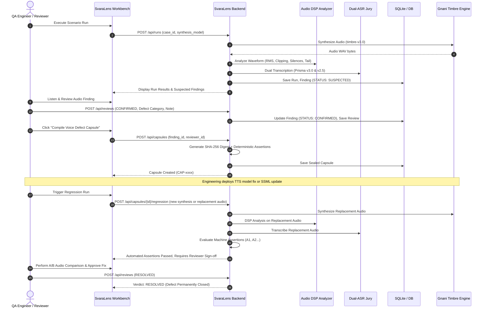

# SvaraLens Pro — Voice Defect Capsule & Regression Workflow

## 1. The Core Differentiator: Spoken Defect to Reproducible Test

In modern Conversational AI workflows, quality assurance often stops at text-based evaluation (evaluating LLM completions). However, in voice bots (banking, insurance, collections), catastrophic failures occur **in the acoustic and phonetic rendering**:
- An amount like *₹4,500* is mispronounced or dropped.
- The closing mandatory compliance disclosure is truncated mid-syllable.
- A sudden burst of digital clipping bursts the user's eardrum.
- An abrupt language switch (Hindi $\to$ English) introduces robotic stutter.

**SvaraLens Pro transforms these transient acoustic defects into permanent, cryptographically sealed Voice Defect Capsules that run as regression tests.**

---

## 2. The 10-Defect Assertion Taxonomy

When a defect is confirmed by a QA reviewer, SvaraLens automatically generates a deterministic set of machine-executable assertions. SvaraLens enforces a fixed contract across all 10 defect types:

| Defect Category | Generated Assertions | Evaluation Method |
|---|---|---|
| **`END_TRUNCATION`** | 1. Mandatory final sentence present in transcript 2. `no_end_truncation` (Tail energy $< -40\text{ dBFS}$) 3. `reviewer_approval_required` | Multi-modal: Dual-ASR + DSP Tail RMS + Reviewer Sign-off |
| **`AMOUNT_MISPRONUNCIATION`** | 1. Exact amount token present without digit corruption 2. `reviewer_approval_required` | Dual-ASR Jury token match + Native speaker phoneme verification |
| **`DATE_OR_NUMBER_DISTORTION`** | 1. Date/numerical token matches ground truth reference 2. `reviewer_approval_required` | Dual-ASR Jury token match + Reviewer confirmation |
| **`CRITICAL_PHRASE_MISSING`** | 1. Missing phrase present in transcript 2. `reviewer_approval_required` | Substring & fuzzy token consensus ($\ge 85\%$) |
| **`ACOUSTIC_CLIPPING`** | 1. `no_clipping` (clipping ratio $< 0.001$) 2. `reviewer_approval_required` | DSP peak amplitude & rail sample count |
| **`UNEXPECTED_SILENCE`** | 1. `no_excessive_silence` (no gap $> 1.2\text{s}$, leading $< 1.5\text{s}$) 2. `reviewer_approval_required` | DSP energy frame stride analysis |
| **`CODE_SWITCH_GLITCH`** | 1. `code_switch_consistency` (phonetic stability across language boundaries) 2. `reviewer_approval_required` | ASR Hindi-English token alignment + Native speaker sign-off |
| **`UNNATURAL_CADENCE`** | 1. `speaking_pace_in_range` ($2.5 - 4.5$ syllables/sec) 2. `reviewer_approval_required` | Syllable-rate estimation + Reviewer cadence rating |
| **`PRONUNCIATION_ANOMALY`** | 1. Specific entity pronunciation accuracy check 2. `reviewer_approval_required` | Dual-ASR token agreement + Reviewer listening |
| **`OTHER`** | 1. Generic reference phrase match 2. `reviewer_approval_required` | General QA verification |

---

## 3. Cryptographic Capsule Sealing & Integrity

### 3.1 SHA-256 Audio Digest
When a capsule is compiled, the baseline audio file on disk is hashed using SHA-256:

$$\text{audio\_sha256} = \text{"sha256:"} + \text{HexDigest}\left(\text{SHA-256}(x_{\text{bytes}})\right)$$

This hash is permanently embedded in the capsule metadata (`spec_json`) and database record.

### 3.2 Tamper Verification
The endpoint `GET /api/capsules/{id}/validate` dynamically re-reads the underlying audio file from disk, recalculates its SHA-256 digest, and compares it against the stored baseline:
- If matching: Returns `valid: true`, guaranteeing the audio evidence has not been modified, replaced, or degraded.
- If mismatched: Returns `valid: false` with both hashes, alerting the QA engineer of tampering or file system corruption.

---

## 4. End-to-End Defect-to-Regression Lifecycle

---

## 5. Regression Verdict Determination

During a regression run (`POST /api/capsules/{id}/regression`), SvaraLens evaluates both machine metrics and human approval:

1. **Automated Assertion Failure:**
   - If any automated assertion fails (e.g., clipping ratio still exceeds threshold, or missing critical phrase remains absent from ASR transcript):
   - **Verdict:** `STILL_FAILING`.
2. **Automated Assertions Passed, Awaiting Human Review:**
   - If all machine assertions pass, but the capsule requires native-language phonetic sign-off (`reviewer_approval_required`):
   - **Verdict:** `NEEDS_REVIEW`.
3. **Automated Assertions Passed + Human Signed-off:**
   - If machine assertions pass and native-speaker reviewer approves the replacement audio:
   - **Verdict:** `RESOLVED`.
