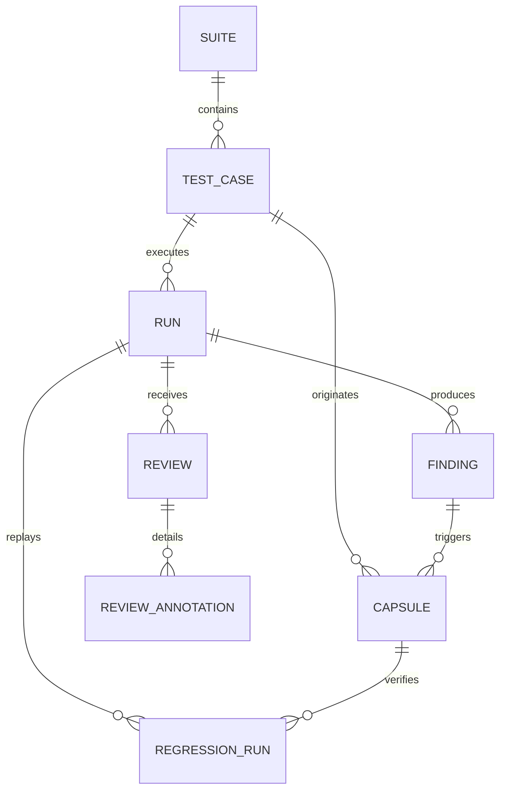

# SvaraLens Pro — Database Schema Specification

## Storage Engine
* **Local/Demo:** SQLite (`data/svaralens.db`).
* **Production Ready:** Direct PostgreSQL compatibility with SQLAlchemy Declarative Models.

---

## Entity Relationship Diagram

---

## 1. `suites` Table
Represents test suites grouping related voice scenarios.
* `id` (VARCHAR, PK): Unique suite key (e.g. `suite-insurance-hi`).
* `name` (VARCHAR): Descriptive suite name.
* `description` (TEXT): Suite scope and objectives.
* `created_at` (VARCHAR, ISO-8601).

---

## 2. `test_cases` Table
Stores ground-truth test specifications.
* `id` (VARCHAR, PK): e.g. `TC-001`, `TC-014`.
* `suite_id` (VARCHAR, FK -> suites.id).
* `scenario` (VARCHAR): Scenario title.
* `title` (VARCHAR, Nullable): Alias title.
* `description` (TEXT, Nullable).
* `language` (VARCHAR): `hi-IN` or `hinglish`.
* `dialect` (VARCHAR): `standard`, `conversational`, or `telephony`.
* `reference_text` (TEXT): Expected golden script (Devanagari or Hinglish).
* `critical_phrases_json` (TEXT): JSON array of mandatory tokens `[{text, variants[], severity}]`.
* `critical_entities_json` (TEXT, Nullable): JSON array of expected amounts, dates, policy IDs.
* `voice` (VARCHAR): Default voice persona (e.g. `Shivani`, `Nalini`).
* `tts_model` (VARCHAR): `timbre-v3.0` or `timbre-v2.5`.
* `speed` (FLOAT): Target speaking rate factor (default `1.0`).
* `channel` (VARCHAR): `standard` (16kHz studio) or `tel_8k` (8kHz IVR).
* `sample_rate` (INTEGER): `16000` or `8000`.
* `pace_min` (FLOAT): Minimum allowed syllable rate (syl/sec).
* `pace_max` (FLOAT): Maximum allowed syllable rate (syl/sec).
* `severity` (VARCHAR): `LOW`, `MEDIUM`, `HIGH`, `CRITICAL`.
* `created_at`, `updated_at` (VARCHAR, ISO-8601).

---

## 3. `runs` Table
Captures every speech synthesis or audio upload execution.
* `id` (VARCHAR, PK): e.g. `RUN-04E86A0D`.
* `case_id` (VARCHAR, FK -> test_cases.id).
* `source` (VARCHAR): `TIMBRE_LIVE`, `UPLOAD`, or `MOCK_FIXTURE`.
* `status` (VARCHAR): `CREATED`, `AUDIO_READY`, `TRANSCRIBED`, `ANALYSED`, `FAILED`.
* `audio_path` (TEXT): Path on disk (`storage/audio/{id}.wav`).
* `audio_sha256` (VARCHAR): SHA-256 byte digest.
* `duration_s` (FLOAT): Measured duration in seconds.
* `sample_rate` (INTEGER): `16000` or `8000`.
* `channels` (INTEGER): `1` (mono).
* `tts_model` (VARCHAR): Timbre engine version.
* `tts_voice` (VARCHAR): Voice persona used.
* `transcript_text` (TEXT): Primary recognized transcript.
* `stt_dual_results_json` (TEXT): Parallel ASR jury results `{prisma_v25, prisma_v30, consensus_score}`.
* `defect_pins_json` (TEXT): JSON array of reviewer-pinned defect intervals.
* `metrics_json` (TEXT): Acoustic DSP measurements (clipping %, peak dBFS, silence intervals, tail RMS).
* `injected_fault` (TEXT, Nullable): Controlled fault (e.g. `END_TRUNCATION`).
* `created_at` (VARCHAR, ISO-8601).

---

## 4. `findings` Table
Represents automated or human-confirmed anomalies.
* `id` (VARCHAR, PK): e.g. `FIND-001`.
* `run_id` (VARCHAR, FK -> runs.id).
* `check_type` (VARCHAR): Check category (`END_TRUNCATION`, `CRITICAL_PHRASE`, `CLIPPING`, `SILENCE`, `PACE`).
* `status` (VARCHAR): `WARN`, `SUSPECTED`, `FAIL`.
* `review_state` (VARCHAR): `AUTO_DETECTED`, `HUMAN_CONFIRMED`, `FALSE_POSITIVE`, `NEEDS_SECOND_REVIEW`.
* `severity` (VARCHAR): `LOW`, `MEDIUM`, `HIGH`, `CRITICAL`.
* `evidence_json` (TEXT): Detailed evidence payload.
* `reviewer_note` (TEXT, Nullable).
* `reviewed_by` (TEXT, Nullable).
* `reviewed_at` (VARCHAR, Nullable).

---

## 5. `capsules` Table
Immutable Voice Defect Capsules representing reproducible tests.
* `id` (VARCHAR, PK): e.g. `CAP-TC-014-001`.
* `case_id` (VARCHAR, FK -> test_cases.id).
* `source_finding_id` (VARCHAR, FK -> findings.id).
* `defect_type` (VARCHAR): One of 10 defect taxonomies.
* `severity` (VARCHAR): `CRITICAL`, `HIGH`, `MEDIUM`, `LOW`.
* `review_status` (VARCHAR): `HUMAN_CONFIRMED`.
* `failing_audio_sha256` (TEXT): Fixed SHA-256 hash of original failing audio.
* `spec_json` (TEXT): Immutable test assertion contract.
* `defect_pins_json` (TEXT, Nullable).
* `state` (VARCHAR): `OPEN`, `RESOLVED`, `REOPENED`.
* `created_at` (VARCHAR, ISO-8601).

---

## 6. `regression_runs` Table
Captures execution of capsule assertions against replacement audio.
* `id` (VARCHAR, PK): e.g. `REG-001`.
* `capsule_id` (VARCHAR, FK -> capsules.id).
* `run_id` (VARCHAR, FK -> runs.id).
* `assertion_results_json` (TEXT): Array of Before/After assertion checks `[{id, before, after, detail}]`.
* `verdict` (VARCHAR): `RESOLVED`, `STILL_FAILING`, `REGRESSED`, `NEEDS_REVIEW`.
* `approved_by` (TEXT, Nullable).
* `approved_at` (VARCHAR, Nullable).
* `created_at` (VARCHAR, ISO-8601).

---

## 7. `audit_events` Table
Append-only tamper-evident event log.
* `id` (VARCHAR, PK): e.g. `AUD-001`.
* `entity_type` (VARCHAR): `CASE`, `RUN`, `CAPSULE`, `REGRESSION`, `REVIEW`.
* `entity_id` (VARCHAR).
* `action` (VARCHAR): `CREATE`, `UPDATE`, `COMPILE`, `RERUN`, `APPROVE`, `REOPEN`.
* `actor` (VARCHAR): Identity or system role.
* `details_json` (TEXT).
* `created_at` (VARCHAR, ISO-8601).
